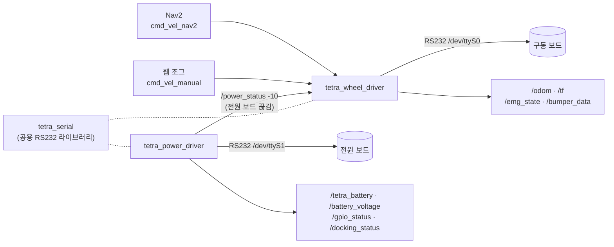
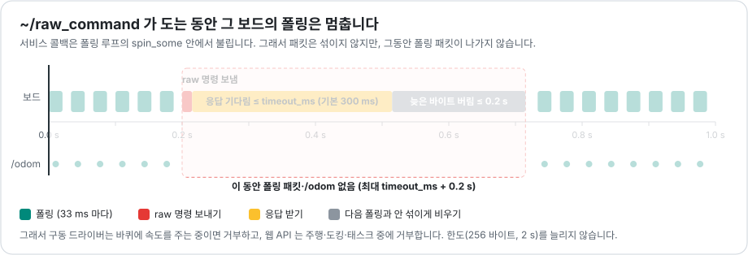
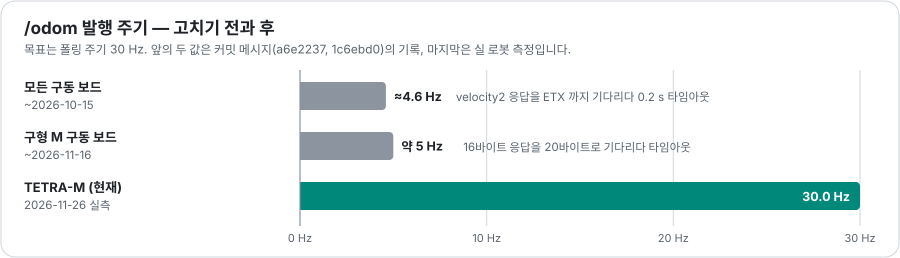

<div align="center">
  
  <h1>tetra_driver</h1>
  <p><b>TETRA 의 구동 보드(바퀴)와 전원 보드(배터리·비상정지·GPIO)를 ROS 2 에 잇는 시리얼 드라이버</b></p>
  
  
  
</div>

> 전체 시스템(웹 관제, 브링업, 다른 ROS 패키지)은 [tetra_integration README](https://github.com/TETRA-ROBOT/tetra_integration) 를 보세요.

## 한눈에 보기

- 노드 두 개가 각자 보드 하나를 맡아 **30 Hz 로 폴링**합니다. 한 주기(33 ms)에 명령을 보내고 응답을 읽어 토픽으로 냅니다.
- `tetra_wheel_driver` → 구동 보드: 속도 명령을 바퀴로 보내고, 보드가 계산한 오도메트리를 `/odom`·`/tf` 로 냅니다.
- `tetra_power_driver` → 전원 보드: 배터리·충전 접점·비상정지·GPIO·초음파·리프트 상태를 냅니다.
- 시리얼 코드는 `tetra_serial` 한 곳에만 있습니다. 보드가 끊기면 바퀴를 세우고 2초마다 포트를 다시 엽니다.



## 🚀 빠른 시작

1. 빌드합니다 (워크스페이스 루트, `interfaces` 패키지가 같이 있어야 합니다).
   ```bash
   colcon build --symlink-install --packages-up-to tetra_wheel_driver tetra_power_driver
   source install/setup.bash
   ```
2. 실 로봇에서는 브링업이 두 노드를 같이 띄웁니다 (`tetra_integration/scripts/start_real_robot.sh start`).
   드라이버만 따로 띄우려면:
   ```bash
   ros2 launch tetra_wheel_driver tetra_wheel_driver.launch.py robot_model:=m
   ```
   ```bash
   ros2 launch tetra_power_driver tetra_m_power_driver.launch.py
   ```
3. 보드와 이야기하고 있는지 봅니다. 둘 다 30 Hz 가 나오면 정상입니다.
   ```bash
   ros2 topic hz /odom
   ```

하드웨어가 없으면 가상 보드로 실제 노드를 띄워 볼 수 있습니다: [`tools/board_sim/README.md`](tools/board_sim/README.md).

## 📦 구성

| 폴더 | 하는 일 | 자세히 |
|---|---|---|
| `tetra_wheel_driver/` | 구동 보드: 바퀴 속도, 오도메트리, 비상정지·범퍼·모터 에러, 서보 | [README](tetra_wheel_driver/README.md) |
| `tetra_power_driver/` | 전원 보드: 배터리·전압·전류, 충전 접점, GPIO·LED, 초음파, 컨베이어·리프트 | [README](tetra_power_driver/README.md) |
| `tetra_serial/` | 두 드라이버가 같이 쓰는 RS232 포트 설정·패킷 읽기/쓰기, raw 명령 주고받기 (정적 라이브러리) | `include/tetra_serial/*.h` |
| `tools/board_sim/` | 가상 구동·전원 보드와 시나리오 테스트 (하드웨어 없이 확인) | [README](tools/board_sim/README.md) |
| `*/src/legacy_archive/` | 예전 모델별 코드. **빌드하지 않는 참고용**입니다 | - |

Pan/Tilt HerkuleX 서보는 이 레포가 아니라 `tetra_dependency/herkulex_driver` 를 씁니다.

## 🧭 자주 하는 작업

| 하고 싶은 일 | 명령 |
|---|---|
| 바퀴를 조금 움직여 보기 (0.5초 끊기면 멈춤) | `ros2 topic pub -r 10 /cmd_vel_manual geometry_msgs/msg/Twist "{linear: {x: 0.1}}"` |
| 배터리 잔량(%) 보기 | `ros2 topic echo /tetra_battery` |
| 에러로 꺼진 서보 다시 켜기 | `ros2 topic pub --once /servo_on std_msgs/msg/Int32 "{data: 1}"` |
| 오도메트리 0 으로 되돌리기 | `ros2 topic pub --once /pose_reset std_msgs/msg/Int32 "{data: 1}"` |
| 구동 보드 펌웨어 날짜·버전 | `ros2 service call /drive_version_read_cmd interfaces/srv/PowerVersionRead "{}"` |
| 전원 보드 펌웨어 날짜·버전 | `ros2 service call /power_version_read_cmd interfaces/srv/PowerVersionRead "{}"` |
| 오도메트리 보정 배율 보기 | `ros2 param get /tetra_wheel_driver odom_linear_scale` |
| 구형 구동 보드인지 확인 | `ros2 topic echo --once /drive_board_incompatible` |
| 리프트 위치 보기 (MH, `lift_position_option`) | `ros2 topic echo /lift_status` |
| 보드에 임의 바이트 보내기 | 아래 [보드 명령 테스트](#보드-명령-테스트-raw_command) |

오도메트리 보정 배율은 웹 관제 관리자 화면 "바퀴 오도메트리 보정"(`tetra_util/tetra_odom_calibration`)이 재서 넣습니다.

## 📡 인터페이스

코드(`tetra_wheel_driver.cpp`, `tetra_power_driver.cpp`)에서 확인한 이름입니다. 이름은 소문자 스네이크 케이스입니다.

<details open>
<summary><b>tetra_wheel_driver</b> (구동 보드, 기본 포트 <code>/dev/ttyS0</code>)</summary>

| 방향 | 이름 | 타입 | 설명 |
|---|---|---|---|
| 발행 | `/odom` | `nav_msgs/Odometry` | 30 Hz. twist 는 `base_footprint` 기준. 보드를 못 읽은 주기는 내지 않음 |
| 발행 | `/tf` | odom → base_footprint | `ekf_option` 이 false 일 때만 (true 면 EKF 가 냄) |
| 발행 | `/emg_state`, `/bumper_data` | `std_msgs/Int32` | 비상정지, 범퍼·서보 비트 |
| 발행 | `/left_error_code`, `/right_error_code` | `std_msgs/Int32` | 모터 드라이버 에러 코드 |
| 발행 | `/drive_board_incompatible` | `std_msgs/Bool` (latched) | velocity2 를 모르는 구형 보드 응답이 20번 이어지면 true |
| 구독 | `/cmd_vel_nav2` | `geometry_msgs/Twist` | Nav2 최종 명령 (`cmd_vel_nav → velocity_smoother → collision_monitor`). 도킹도 이 토픽 |
| 구독 | `/cmd_vel_manual` | `geometry_msgs/Twist` | 웹 조그·보정 도구 |
| 구독 | `/cmd_vel_nav` | `geometry_msgs/Twist` | **기본은 구독 안 함** (`use_raw_nav_cmd:=true` 일 때만) |
| 구독 | `/servo_on` | `std_msgs/Int32` | 1 = 에러 해제 후 서보 ON, 2 = 서보 OFF |
| 구독 | `/power_status` | `std_msgs/Int32` | -10 이면 서보 OFF (전원 보드 끊김) |
| 구독 | `/pose_reset`, `/accel_vel`, `/joy` | | 오도메트리 리셋(1), 가속 파라미터, 조이스틱 |
| 서비스 | `param_read_cmd`, `param_write_cmd` | `interfaces/srv/ParameterRead`·`ParameterWrite` | 구동 보드 파라미터 |
| 서비스 | `mode_change_cmd`, `linear_move_cmd`, `angular_move_cmd` | `SetMoveMode`, `LinearPositionMove`, `AngularPositionMove` | 위치 모드 이동 |
| 서비스 | `servo_cmd` | `interfaces/srv/Servo` | 서보 ON/OFF |
| 서비스 | `drive_version_read_cmd` | `interfaces/srv/PowerVersionRead` | 구동 보드 펌웨어 버전 |
| 서비스 | `/tetra_wheel_driver/raw_command` | `interfaces/srv/BoardRawCommand` | 보드 명령 테스트. 바퀴에 속도를 주는 중이면 거부 |

| 파라미터 | 기본값 | 설명 |
|---|---|---|
| `port` | `/dev/ttyS0` | 구동 보드 포트 (열 때 TIOCEXCL 로 잠금) |
| `robot_model` | `m` | 바퀴 반지름·간격 선택 (`m`, `h`, `edu`, `mh`, `s`, `sm`). **브링업에서 꼭 넘깁니다** |
| `wheel_radius`, `wheel_distance`, `tread_width` | 0 | 0 보다 크면 모델 값 대신. 속도 명령 변환에만 쓰고 오도메트리에는 영향 없음 |
| `ekf_option` | false | true 면 odom→base_footprint TF 를 내지 않음 (예전 이름 `m_bEKF_option` 도 경고와 함께 읽음) |
| `cmd_vel_timeout` | 0.5 | 이 시간(초) 동안 속도 명령이 없으면 정지. 0 이하면 끔 |
| `max_linear_velocity`, `max_angular_velocity` | 2.0, 2.0 | 속도 상한 (m/s, rad/s) |
| `use_raw_nav_cmd` | false | true 면 예전처럼 `cmd_vel_nav` 도 받음 (collision_monitor 를 우회하므로 권하지 않음) |
| `emg_releases_servo` | false | 비상정지를 누르면 서보를 풀고, 풀리면 다시 켬. 서보 버튼이 없는 구형 M 용 |
| `publish_odom_covariance` | false | `/odom` 에 공분산을 실음 (M 런치는 true, `ekf_m.yaml` 이 이 값에 맞춰져 있음) |
| `odom_linear_scale`, `odom_angular_scale` | 1.0 | 오도메트리 보정 배율 (0.8~1.2). 바꾸면 바로 쓰고 `odom_scale_file` 에 남김 |
| `odom_scale_file` | `~/.config/tetra/wheel_odom_scale.txt` | 보정 배율 저장 파일 |

</details>

<details>
<summary><b>tetra_power_driver</b> (전원 보드, 기본 포트 <code>/dev/ttyS1</code>)</summary>

| 방향 | 이름 | 타입 | 설명 |
|---|---|---|---|
| 발행 | `/tetra_battery` | `std_msgs/Int32` | 배터리 잔량 % |
| 발행 | `/battery_voltage`, `/battery_current` | `std_msgs/Float64` | V, A |
| 발행 | `/docking_status` | `std_msgs/Int32` | 충전 접점 상태 (도킹 플러그인이 `contact_status_val` 과 비교) |
| 발행 | `/gpio_status` | `interfaces/msg/Gpio` | 입출력 16개 |
| 발행 | `/power_status` | `std_msgs/Int32` | 보드 읽기 결과. 끊기면 -10 을 한 번 |
| 발행 | `/servo_on` | `std_msgs/Int32` | 보드가 끊긴 동안 2 (서보 OFF) 를 계속 |
| 발행 | `/ultrasonic_dl`·`_rl`·`_rr`·`_dr` | `sensor_msgs/Range` | `ultrasonic_option` 일 때. 예전 이름 `Ultrasonic_D_L` 등 |
| 발행 | `/range_points_dl`·`_rl`·`_rr`·`_dr` | `sensor_msgs/PointCloud2` | 초음파 장애물 점. 감지 없음이면 빈 점군 |
| 발행 | `/conveyor_sensor`, `/conveyor_movement` | `std_msgs/Int32` | `conveyor_option` 일 때 |
| 발행 | `/lift_status` | `std_msgs/Int32` | `lift_position_option` 일 때 10 Hz. 0 = 가장 높음 ~ 764 = 가장 낮음 |
| 서비스 | `led_cmd`, `led_toggle_cmd`, `turn_on_cmd` | `LedControl`, `LedToggleControl`, `ToggleOn` | LED (`turn_on_cmd` 는 보드 LT = LED 채널, 리프트 아님) |
| 서비스 | `power_outport_cmd`, `power_single_outport_cmd`, `power_enable_cmd`, `power_single_enable_cmd`, `power_io_status_cmd`, `power_wheel_enable_cmd` | `Power*` | 출력 포트·IO |
| 서비스 | `power_parameter_read_cmd`, `power_parameter_write_cmd`, `power_data_read_cmd`, `power_adc_read_cmd`, `power_version_read_cmd`, `log_cmd` | `Power*`, `Integrallog` | 보드 파라미터·데이터 |
| 서비스 | `power_sonar_read_cmd`, `power_sonar_start_cmd` | `PowerSonarRead`, `PowerSonarCmd` | 초음파 |
| 서비스 | `conveyor_auto_move_cmd` | `ConveyorAutoMovement` | 보드 CN = **리프트** (H: 0 원점·1 중간·2 최대, M 리프트 컨베이어: 0 내림·1 올림) |
| 서비스 | `conveyor_manual_move_cmd` | `ConveyorManualMovement` | 보드 CC = 컨베이어 (0 정지·1 정회전·2 역회전) |
| 서비스 | `conveyor_parameter_read_cmd`, `conveyor_parameter_write_cmd`, `conveyor_data_read_cmd` | `Conveyor*` | 컨베이어 파라미터·데이터 |
| 서비스 | `/tetra_power_driver/raw_command` | `interfaces/srv/BoardRawCommand` | 보드 명령 테스트 |

예전 대문자 서비스 이름(`/Power_outport_cmd`, `/Conveyor_auto_move_cmd` 등)도 같은 동작으로 열려 있습니다. 새 코드는 소문자 이름을 씁니다.

| 파라미터 | 기본값 | 설명 |
|---|---|---|
| `port` | `/dev/ttyS1` | 전원 보드 포트 |
| `conveyor_option` | false | 컨베이어 상태 발행 (예전 이름 `m_bConveyor_option`) |
| `ultrasonic_option` | false | 초음파 켜기·발행 (예전 이름 `m_bUltrasonic_option`) |
| `ultrasonic_max_range` | 0.5 | 초음파 최대 거리(m). 이 값 이상과 0 은 "감지 없음". 보드 파라미터 `p5_sonar_max_distance`(mm)와 맞춥니다 |
| `lift_position_option` | false | 리프트 위치를 `/lift_status` 로 (MH 브링업 true). 읽기에 실패한 주기는 내지 않음 |

</details>

### 보드 명령 테스트 (`~/raw_command`)

관리자 화면(관리자 설정 → 보드 명령 테스트, API `POST /board/command`)이 보드에 임의 바이트를 보내고 응답을 그대로 보는 서비스입니다.
펌웨어 확인·새 명령 시험용이며, **모터를 움직이거나 보드 파라미터를 바꾸는 명령도 막지 않습니다.**

| 서비스 | 보드 |
|---|---|
| `/tetra_wheel_driver/raw_command` | 구동 보드 (바퀴에 속도를 주는 중이면 거부) |
| `/tetra_power_driver/raw_command` | 전원 보드 |

타입은 `interfaces/srv/BoardRawCommand` (`tetra_dependency/interfaces/srv/BoardRawCommand.srv`):

- `data` 1~256 바이트, `framing` = `FRAMING_RAW`(그대로) / `FRAMING_PROTOCOL`(STX + data + ETX + LRC, LRC 는 data..ETX 의 XOR — 기존 명령과 같은 틀)
- `read_mode` = `READ_UNTIL_IDLE`(응답이 30ms 끊길 때까지) / `READ_ASCII_FRAME`(LRC 가 맞는 ETX 까지) / `READ_LENGTH_FRAME`(STX 길이 데이터 ETX LRC, 전원 보드 데이터 응답) / `READ_NONE`
- `timeout_ms` 0 이면 300, 최대 2000. `max_reply_length` 0 이면 256, 최대 256
- 응답: `success`, `message`, `sent`(실제로 보낸 바이트), `reply`(받은 바이트 그대로, 실패해도 받은 만큼), `elapsed_ms`

```bash
ros2 service call /tetra_power_driver/raw_command interfaces/srv/BoardRawCommand "{data: [80, 86], framing: 1, read_mode: 2, timeout_ms: 300}"
```

<p align="center"></p>

**폴링과 섞이지 않는 이유**: 두 드라이버는 30Hz 폴링 루프 안에서 `rclcpp::spin_some` 으로 서비스 콜백을 부릅니다 (스레드 하나).
그래서 raw 명령이 도는 동안에는 폴링 패킷이 나가지 않고, 응답도 폴링 쪽이 읽어 가지 않습니다. 보내기 전에는 `send_packet` 이 남은 수신 데이터를 버리고,
받은 뒤에는 늦게 오는 바이트를 조용해질 때까지(최대 0.2초) 버려 다음 폴링 응답으로 읽히지 않게 합니다 (`tetra_serial/rs232_raw.c`).
대신 그동안(최대 `timeout_ms` + 0.2초) 그 보드의 폴링이 멈춥니다: 구동 보드는 오도메트리·속도 명령, 전원 보드는 배터리·비상정지 상태가 그만큼 늦습니다.
그래서 구동 드라이버는 바퀴에 속도를 주는 중이면 거부하고, 웹 API 는 주행·도킹·태스크 중에 거부합니다.

공통 처리(검사·틀 씌우기·응답 문구)는 `tetra_serial/include/tetra_serial/raw_command_service.hpp` 한 곳에 있습니다.
가상 보드 확인: `tools/board_sim/test_raw_command.py`.
드라이버를 멀티스레드 실행기로 바꾸면 시리얼 접근에 잠금을 따로 둬야 합니다. 한도(256 바이트, 2초)는 늘리지 않습니다.

## 📊 벤치마크

**토픽 주기 (실측)** — 구동·전원 보드 토픽이 모두 30 Hz 인 것은 두 드라이버가 보드를 30 Hz(`rclcpp::WallRate loop_rate(30)`)로 폴링하기 때문입니다.

| 토픽 | 낸 노드 | 주기 | 주기 흔들림(표준편차) | 메시지 지연(헤더→수신 중앙값) |
|---|---|---|---|---|
| `/odom` | tetra_wheel_driver | 30.0 Hz | 2.8 ms | 0.5 ms |
| `/emg_state` | tetra_wheel_driver | 30.0 Hz | 0.4 ms | - (헤더 없음) |
| `/tetra_battery`, `/battery_voltage`, `/gpio_status` | tetra_power_driver | 30.0 Hz | 1.8 ms | - (헤더 없음) |
| `/Ultrasonic_R_L` (Range) | tetra_power_driver | 30.0 Hz | 1.8 ms | 5.5 ms |

> 2026-11-26, TETRA-M 실기, 정지·대기 상태, Nav2 로컬라이제이션 실행 중, i7-10700 16스레드, rclpy 로 20초 구독.
> 측정한 로봇은 이름을 소문자로 바꾸기(2026-11-19, `527532f`) 전 빌드라서 초음파 토픽이 예전 이름 `/Ultrasonic_R_L` 입니다. 지금 이름은 `/ultrasonic_rl` 입니다.

**고치기 전과 후 (커밋 기록)**

<p align="center"></p>

| 날짜 | 무엇 | 전 | 후 | 출처 |
|---|---|---|---|---|
| 2026-10-16 | velocity2 응답 읽기 (ETX 를 기다리다 0.2 s 타임아웃) | `/odom` ≈4.6 Hz | 30 Hz | 커밋 `a6e2237` |
| 2026-11-17 | 구형 M 구동 보드 (16바이트 응답을 20바이트로 기다림) | 약 5 Hz, 조그를 놓아도 한참 더 감 | 30 Hz | 커밋 `1c6ebd0` |
| 2026-10-23 | 과부하가 계속될 때 모터 리셋·서보 ON | 7초에 210번 (매 주기) | 1초 간격 3번 뒤 서보 OFF | 커밋 `9a1b6fd` |
| 2026-10-23 | 속도 상한 없음 | 10 m/s 요청이 바퀴에서 6 m/s | 2.0 m/s·2.0 rad/s 로 자름 | 커밋 `9a1b6fd` |
| 2026-10-23 | 전원 보드 끊김 → 바퀴 정지 | 10번 넘게 실패한 뒤(≈2.5 s) | 3번(≈0.7 s) 뒤 `/power_status` -10 | 커밋 `9a1b6fd` |
| 2026-11-17 | 주행 중 방향을 바퀴가 이끌게 (`publish_odom_covariance`) | IMU 가 이끈 EKF 가 5분 탐사 끝에 53° 어긋남 | 바퀴 방향이 SLAM 방향과 3.8° (RMS) 안 | 커밋 `5f91cde` (M, 녹화한 5분 탐사) |

같은 기록에서: iAHRS 자이로는 주행 진동으로 0.2~0.4°/s 흘렀고 반시계 회전을 2.5% 짧게 읽었습니다 (`5f91cde`).

**빌드 시간** (2026-11-18 증분 빌드 로그, 45 패키지, 전체 2분 27초): `tetra_power_driver` 74 s, `tetra_wheel_driver` 73 s.

## 🛠 문제 해결

<details>
<summary><code>/odom</code> 이 안 나오거나 "구동보드 응답이 없습니다"</summary>

구동 보드를 연속 15번(약 0.5초) 읽지 못하면 `/odom` 발행을 멈추고 2초마다 포트를 다시 엽니다. 다시 붙으면 "구동보드 통신이 복구되었습니다" 가 찍힙니다.
케이블·보드 전원·`port` 파라미터를 확인하세요. 포트는 TIOCEXCL 로 잠그므로 **다른 프로세스(예: 시리얼 터미널)가 같은 포트를 열고 있으면 실패**합니다.
</details>

<details>
<summary><code>/odom</code> 이 30 Hz 가 아니라 5 Hz 근처로 나옴</summary>

예전에는 구형 M 구동 보드의 16바이트 velocity2 응답을 20바이트로 기다리다 매 주기 0.2초 타임아웃이 걸렸습니다 (조그에서 손을 떼도 한참 더 감).
지금은 `drive_module.c` 가 짧은 프레임이 이어지면 스스로 16바이트로 읽습니다. 그래도 느리면 최신 코드로 빌드했는지 확인하세요.
</details>

<details>
<summary>"drive board incompatible" 경고가 웹에 뜸</summary>

velocity2 를 모르는 구형 펌웨어가 짧은 ACK(`02 32 03`)만 20번 이어 보내면 `/drive_board_incompatible` 이 true 가 됩니다.
보드가 비상정지 중에 주행 명령을 FLAG_FAIL(`02 32 03`)로 거부하는 것은 세지 않습니다. 새로 플래시한 보드는 시작할 때 속도 모드로 넣으므로 다시 켜 보세요.
</details>

<details>
<summary>모터 에러 뒤 바퀴가 안 움직임</summary>

비상정지('1')·저전압('5')은 1초마다 리셋을 시도합니다. 그 밖의 에러(과부하, 엔코더 등)는 1초 간격으로 3번까지만 리셋·서보 ON 을 시도하고,
그래도 남으면 서보를 끈 채 멈춥니다. 원인을 없앤 뒤 `/servo_on` 1 또는 `servo_cmd` 1 로 다시 켜세요.
</details>

<details>
<summary>전원 보드가 끊기자 바퀴가 멈춤</summary>

의도한 동작입니다. 전원 보드를 연속 3번(약 0.7초) 읽지 못하면 `/power_status` 에 -10 을 한 번 보내 구동 드라이버가 서보를 끄고,
끊긴 동안 `/servo_on` 2 를 계속 보냅니다. 2초마다 포트를 다시 열고, 다시 연결되면 초기 명령(충전 포트, 초음파)을 다시 보냅니다.
끊김은 한 번만 로그와 `/home/tetra/LOG/*_error.txt` 에 남습니다.
</details>

<details>
<summary>서비스가 <code>command_result: false</code> 를 돌려줌</summary>

`command_result` 는 보드 응답 결과입니다. 응답이 없거나 깨지면 false 이고, 그때 돌려준 값은 쓰지 마세요 (예전에는 늘 true 라 웹 API 가 0 V 배터리 값을 저장했습니다).
</details>

<details>
<summary>초음파가 아무것도 없는데 장애물 점을 냄</summary>

보드는 감지가 없으면 0 이 아니라 자기 최대 거리를 보냅니다. `ultrasonic_max_range` 를 보드 파라미터 `p5_sonar_max_distance`(mm)와 맞추세요.
이 값 이상과 0 은 "감지 없음"으로 보고 `Range` 는 최대 거리, `range_points_*` 는 빈 점군으로 냅니다.
</details>

<details>
<summary>가상 보드 테스트 중 전원 드라이버 'readings resume after reconnect' 가 실패함</summary>

2026-11-17 기록(`4a2ec9d`)에 따르면 이 한 건은 리팩터링 전에도 실패했습니다 (다시 열 때 `Device or resource busy`). 결과는 10/11 이 정상입니다.
</details>

## 📚 더 보기

- [`CONTEXT.md`](CONTEXT.md) — 개발자·AI 에이전트용 주의사항 (단위, 이름 규칙, 리프트·컨베이어 명령, 오도메트리 배율)
- [`tetra_wheel_driver/README.md`](tetra_wheel_driver/README.md) — 안전 동작, 사용 예
- [`tetra_power_driver/README.md`](tetra_power_driver/README.md) — 통신 오류 처리, 초음파·컨베이어 옵션
- [`tools/board_sim/README.md`](tools/board_sim/README.md) — 하드웨어 없이 시나리오 테스트 (바퀴 17, 구형 M 10, 전원 11, raw 명령 15)

## 라이선스

Apache-2.0 ([LICENSE](LICENSE)).
